# How EvelPost evolved

EvelPost started in December 2023 because writing a death notice for a family
member, with the tools available online, was harder than it should be: clunky
interfaces, no care for the culture, and technical problems at the worst
possible moment. This document follows the tool from its first commit to the
current redesign, and explains what changed between the version that is live
today (v2) and the new one (v3).

Detailed records of each version:

- [v2: the current production version](v2-production.md) (live since June 2026)
- [v3: the notice-first redesign](v3-notice-first.md) (November 2026)

## Versions at a glance

| Version | Date | Git | In one line |
| --- | --- | --- | --- |
| Prototype | 12 Dec 2023 | `5390796`, PR #1 | A form above a live preview. |
| Form & preview | 17–21 Dec 2023 | PRs #2–#6 | Card sections, side-by-side layout, nickname and Hebrew date. |
| **v1** | 2 Jan – 6 Feb 2024 | PRs #7–#8, tag `v1` | Export through the print dialog; a mobile layout. |
| **v2** (production) | 24 Jun 2026 | `ae58f74`, tag `v2` | Refresh: opening lines, title, drafts, proper Hebrew dates, safer code. |
| **v3** | Nov 2026 | branch `notice-first-editor` | The notice is the interface; inclusive wording; reliable PDF and image. |

## The test notice

Every screenshot in these documents uses the same notice, entered the same way
in each version, so the versions can be compared fairly. It is deliberately a
little demanding: a hyphenated surname, a nickname, three lines of shiva
details and four lines of mourners.

| Field | Value |
| --- | --- |
| Relation | אבינו, סבנו ובעלנו האהוב |
| Name | אברהם (אבי) כהן-לוינשטיין |
| Funeral | 18.11.2026, 14:30, Hebrew date on, בית העלמין ירקון, שער ב׳ |
| Shiva | השבעה תתקיים בבית המשפחה / רחוב הרצל 12, תל אביב / שעות ביקור 10:00-13:00, 17:00-21:00 |
| Mourners | רעייתו: שרה / ילדיו: דוד, מרים ויוסף / נכדיו: נועה, איתי, תמר ועומר / הנינים וכל המשפחה |

Captured in Chromium at 1440×900 (desktop) and 390×844 (phone). Exports were
captured the way each version produces them; see [Method](#method).

## Timeline

### Prototype (December 2023)

A single column: the browser's default form controls, and the notice below
them. A contributor (guychouk, PR #1) switched the notice to relative `em`
sizes, so the text scales with the page instead of using fixed pixels.

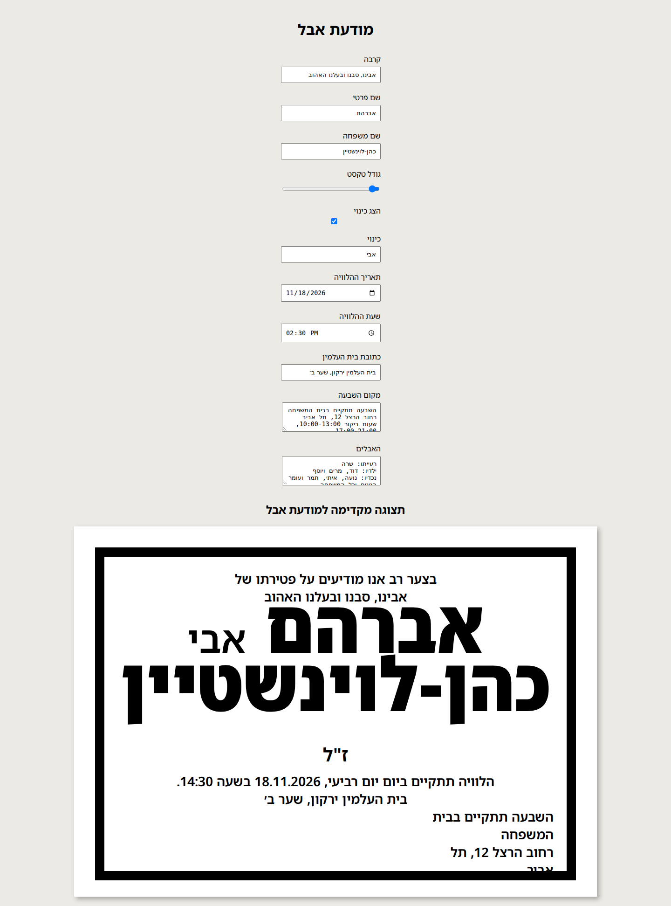

Already visible here, and still present in v2: when the text doesn't fit, it
is cut off at the frame without warning (the mourners are missing entirely).

### Form & preview (December 2023)

The look of EvelPost arrived: grouped card sections (פתיח, שם המנוח, הלוויה,
שבעה), the warm brown palette, the form and the notice side by side, an
optional nickname shown in parentheses, and an optional Hebrew date.

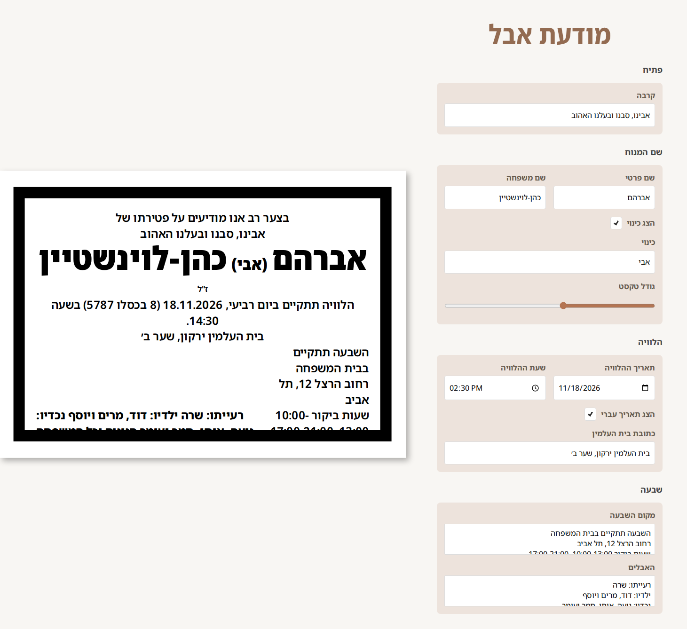

### v1: export and mobile (January – February 2024)

v1 added the ייצוא לקובץ button, which opens the notice in a new tab and calls
the browser's print dialog (A4 landscape), and a mobile layout where the form
stacks above the notice.

| v1 export (print dialog, Chromium) |
| --- |
| 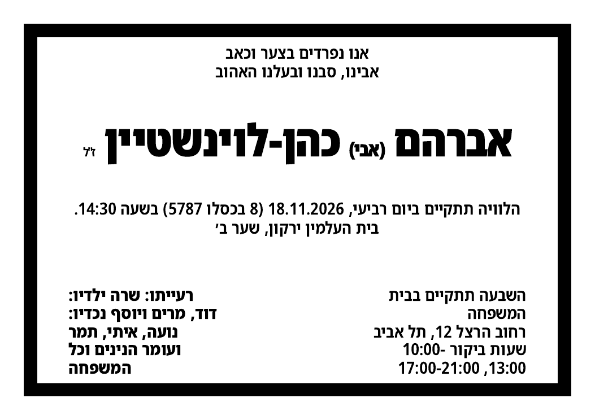 |

Limits of v1, fixed in v2: the page was declared English (`lang="en"`), user
text went into the page unescaped, Hebrew dates came out as `8 בכסלו 5787`
instead of `ח׳ בכסלו תשפ״ז`, line breaks in the mourners field were lost, and
the export waited for the new tab's load event, which after `document.write`
can fire before anything listens for it, leaving the export stuck.

### v2: the refresh (June 2026, current production)

A large rewrite of the same form-and-preview design: a choice of opening
lines (or your own), an optional title, Hebrew dates in Hebrew numerals,
local date parsing (no off-by-one day), escaped user input, drafts saved in
the browser, a reset button, and a notice sized relative to its own width so
the printed page matches the preview.

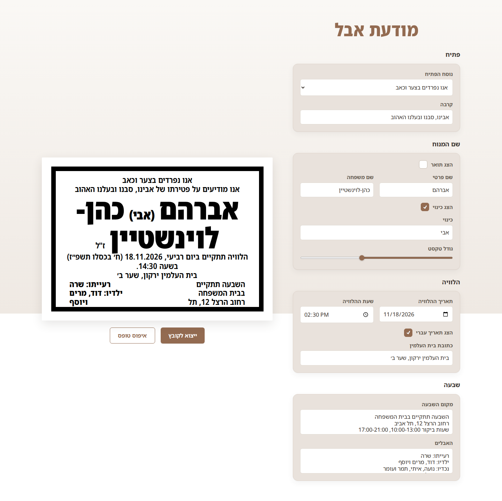

The full record, including what is wrong with it, is in
[v2-production.md](v2-production.md).

### v3: notice-first (November 2026)

The form is gone. The notice is the interface: tap any part of it and a short
step opens for just that part. The rest of this document explains why and
what changed.

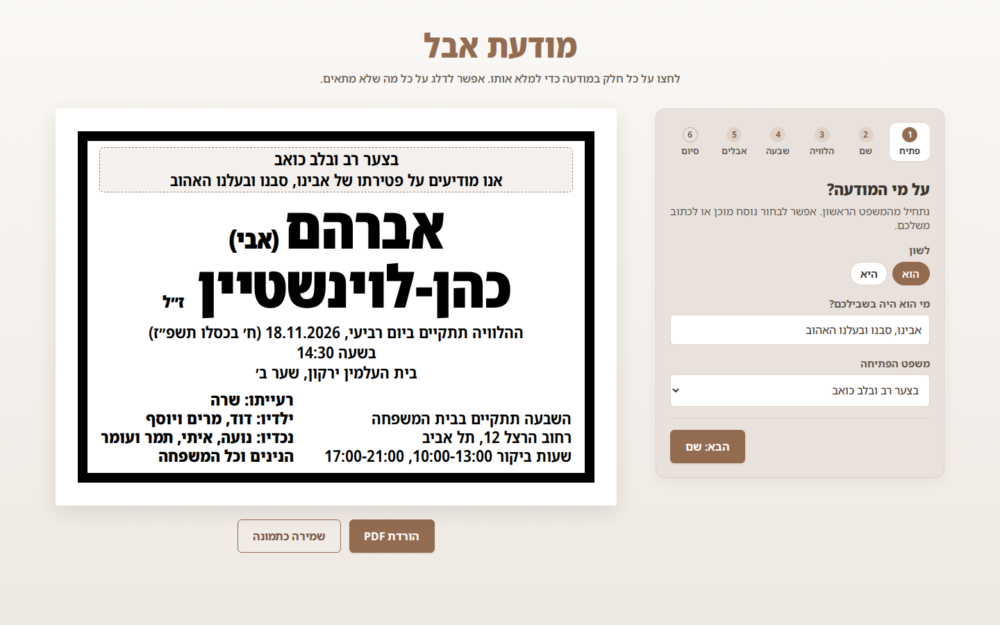

### On phones, version by version

From left: prototype, form & preview, v1, v2, v3. In every version before v3,
the notice is at the bottom of a long form: you type without seeing the
result. In v3 the notice stays pinned at the top while you type.

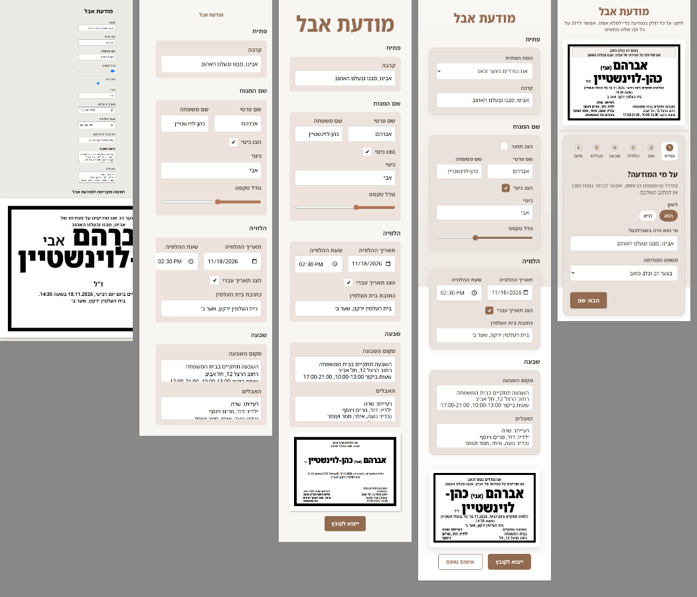

## From v2 to v3: what we improved

The portfolio case study sets out what the tool has to be: user-friendly,
customisable and simple, accessible, free, close to the familiar format,
and printable on home equipment. It also names the next step: supporting
different groups and their language. The review of v2 against those goals
found these gaps:

| Area | v2 (production) | v3 |
| --- | --- | --- |
| Interaction | A long form (16 controls) in four sections | Tap the part of the notice you want to change; optional 6-step guide |
| Empty state | Broken fragments (`ז"ל`, `הלוויה תתקיים ב,`) | Faded example text in place |
| Fitting text | Fixed size; overflow is cut off silently | Shrinks to fit; never cut off |
| Long names | Wrap mid-name, dangling hyphen | Each part kept whole; shrinks if too wide |
| Gender | Male only (פטירתו) | הוא / היא (פטירתו / פטירתה) |
| Honorific | Always ז"ל | ז״ל, ע״ה, זצ״ל, הי״ד or none |
| Ceremony | הלוויה | הלוויה, הלוויה אזרחית or טקס פרידה |
| Output | Print dialog only | PDF file and PNG image, built in the browser |
| PDF reliability | Depends on browser and dialog settings | Same file in every browser, checked before it is offered |
| Sharing | None | Share sheet on phones (e.g. WhatsApp) |
| Seeing the result | Preview scrolls away; below the form on phones | Notice stays in view; last step shows the exact output |
| Printing at home | Heavy frame only, landscape only | Thin, ink-saving frame; portrait or landscape |
| Dependencies | Google Fonts and a CSS CDN | Self-contained |

### 1. From a form to the notice itself

**v2.** The page opens on a long form beside an empty frame. The notice is
something you get after filling in fields; what each field does is only
visible by watching the preview change.

**v3.** The page opens on the notice. Each part of it (the opening, the name,
the funeral, the shiva, the mourners) is a target: tap it and only that part's
questions open, worded the way a person would ask them (״על מי המודעה?״,
״מתי ואיפה נפרדים?״). A row of six steps, and a "הבא" button, guide anyone who
wants to go in order; nothing forces them to.

This is the "guidance without pressure" decision from the case study taken
further: fewer fields in view at once, and the familiar format of the notice
doing the explaining.

### 2. An empty notice that guides instead of looking broken

| v2: empty | v3: empty |
| --- | --- |
| 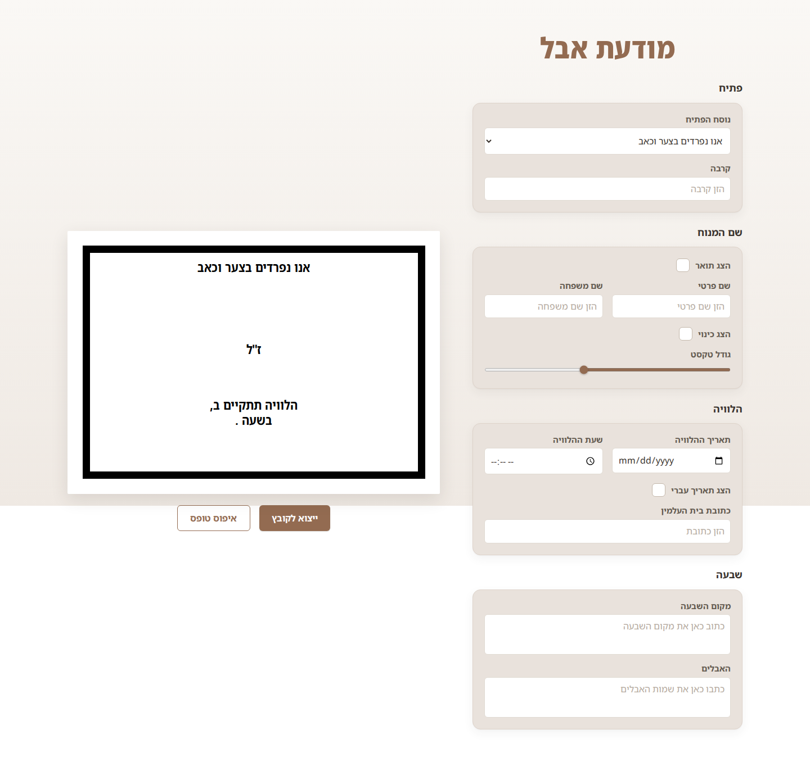 | 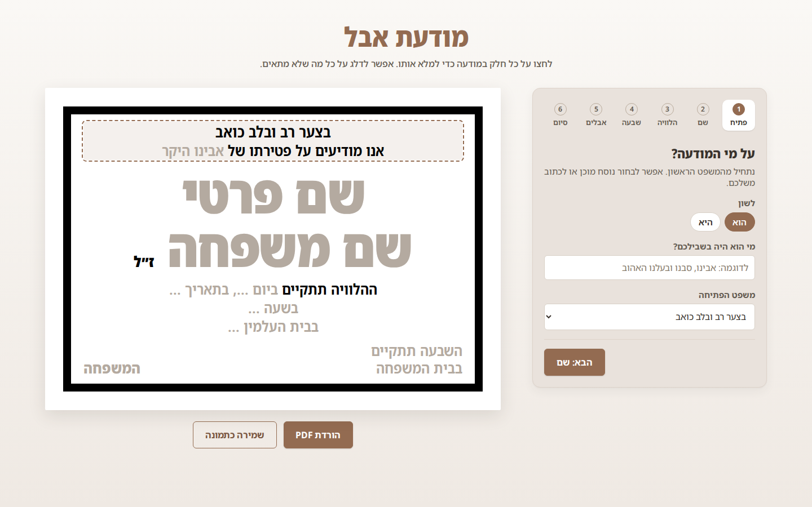 |

v2 assembles the notice from whatever is filled in, so an empty or partial
form shows fragments: a lone `ז"ל`, `הלוויה תתקיים ב,`, `בשעה .`. v3 shows a
faded example in each empty place (`שם פרטי`, `בשעה ...`) that disappears as
the real text arrives. Examples never reach the file, and neither does a line
left incomplete without them (an announcement line with no relation, a
funeral line with no date).

### 3. Nothing is cut off

In v2 the notice has a fixed text size and anything that doesn't fit is
clipped at the frame, without warning. With the test notice, the last line of
the shiva details and two of the four mourner lines are missing, on screen
and in the printout. The same happened in every version before it.

v3 fits the text to the frame: it finds the largest size at which everything
fits (a binary search over the base size), then shrinks only the name if a
single word of it is still too wide. Line breaks stay where the person typed
them; the text gets smaller rather than re-wrapping an address, and time
ranges like `10:00-13:00` never break at the hyphen. The fit is repeated at
print size before export, with a little headroom, so rounding can't clip the
file.

### 4. Wording for different people

The case study names "representing different people" as a core challenge.
v2 could only produce a notice for a man (`אנו מודיעים על פטירתו של`) with
`ז"ל` after the name. v3 adds:

- **הוא / היא**: פטירתו or פטירתה; the relation question and its example
  follow too (״מי היא הייתה בשבילכם?״).
- **After the name**: ז״ל, ע״ה, זצ״ל, הי״ד, or nothing for families who
  don't use one. Written with the proper gershayim (״), not a quote mark.
- **The ceremony**: הלוויה, הלוויה אזרחית, or טקס פרידה, with correct
  grammar (טקס הפרידה **י**תקיים).
- An opening line can now also be left out.

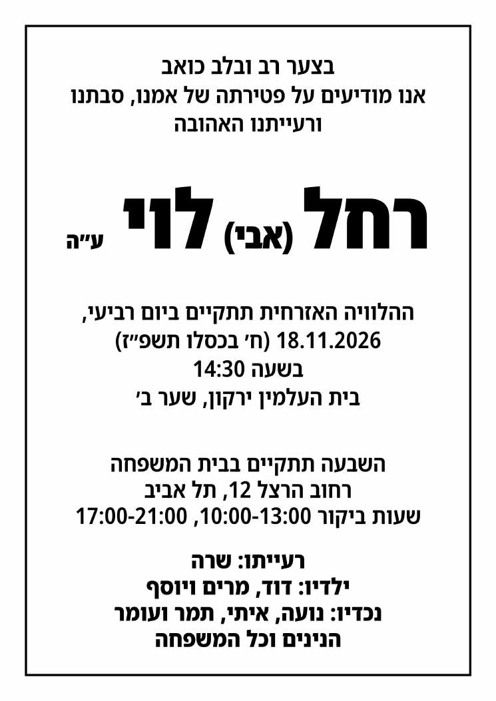

### 5. An export people can trust

The worst moment for a tool like this to fail is at the end, after someone
has carefully filled everything in. v2 hands the notice to the browser's
print dialog, so the result depends on the browser, its margin and scaling
settings, and whether pop-ups are allowed.

When the test notice was exported from v2 through Chromium's print-to-PDF at
100% scale, the notice came out shifted off the page and split over two
pages:

| v2 export, page 1 | v2 export, page 2 |
| --- | --- |
| 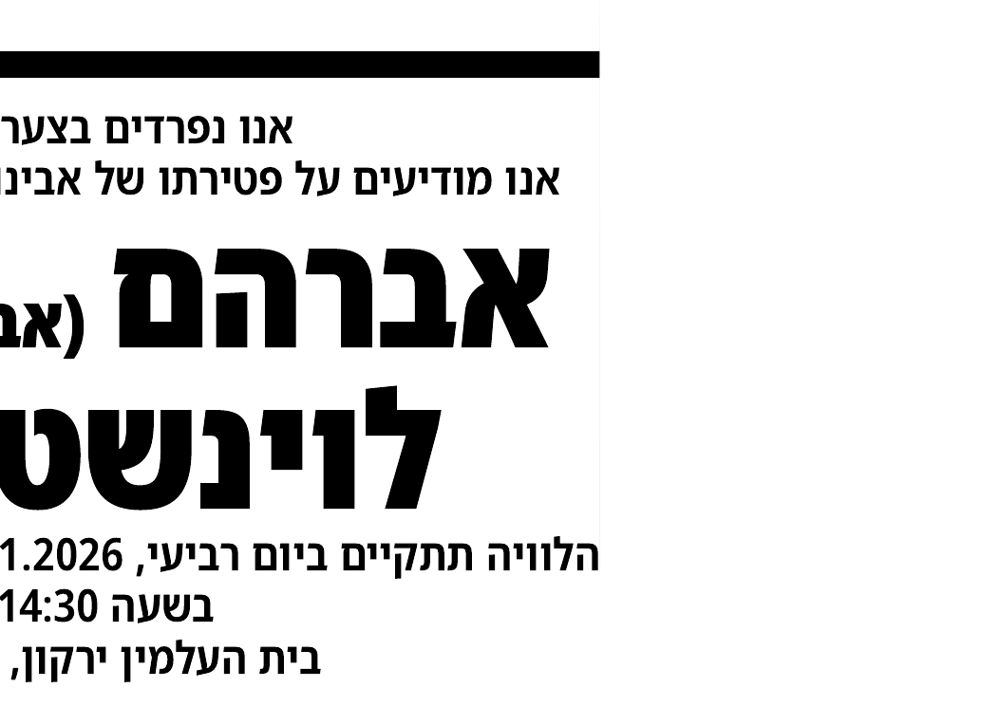 | 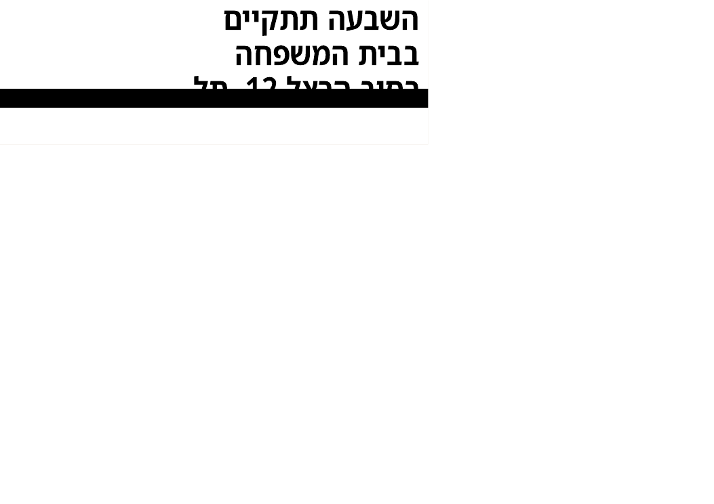 |

The likely cause: the export window loads the app's stylesheet, whose `body`
is a centred flex layout with `min-height: 100vh`, and v2 does not size that
`body` to the page. The A4-sized notice is then centred against the window
rather than the page: measured in the export window, it started 159 px from
the left edge of a 1440 px window. v1's export window fixed its `body` at
exactly 29.7×21 cm and exported the same notice onto one clean page, so this
arrived with the v2 refresh. How visible it is to a real person depends on
the browser and its "fit to page" setting; it was reproduced in the print
engine, not observed on a real device.

v3 does not use the print dialog to make the file:

1. It lays out a clean copy of the notice at 300 dpi A4 (3508×2480 px) off
   screen and fits it again at that size.
2. It renders that copy to an image with the font embedded. Safari gets a
   warm-up render, because it often drops fonts the first time.
3. It checks the render (the frame is there, the text is there) and retries.
   If it still fails, the person is told, their details are safe, and direct
   printing is offered. A broken file is never handed out.
4. It writes the PDF itself: one exact A4 page with the notice's name as its
   title. The same render is offered as a PNG for sharing.

Then a dialog shows the actual file before anything is saved, with download,
share (phones) and open-to-print (desktop). Saving on a fresh tap is what lets
phones open the share sheet, and the preview can be long-pressed and saved in
in-app browsers (Facebook, Instagram) that block downloads.

| Result dialog on a phone | If something fails |
| --- | --- |
|  |  |

Tested in Chromium, Firefox and WebKit on desktop and in iPhone and Android
emulation: one page, exact A4, valid by `qpdf --check`, rendered by poppler,
in 0.3–1 second. Not yet tested on a real phone or on paper.

### 6. Seeing what you will get

On phones, every earlier version put the notice below the whole form. v3 pins
the notice to the top of the screen while you type. On desktop it stays in
view beside the steps.

The last step switches the notice to exactly what the file will contain, and
lists essential details that are still empty; each one is a button that goes
straight to that field.

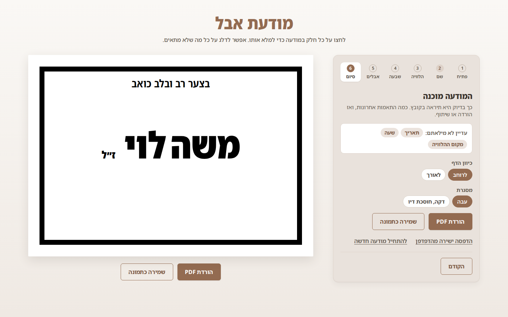

### 7. Smaller things

- Self-hosted font and image library: no requests to Google Fonts or a CDN.
- Placeholder text contrast raised from 2.3:1 to 4.3:1.
- Keyboard access to every part of the notice; real labels and fieldsets for
  the choices.
- "Start a new notice" asks before deleting everything (v2 cleared at once).
- The page title is Hebrew, matching the page.

### What v3 keeps from v2

The palette and typeface, the sizing of the notice relative to its own width
(the idea that makes screen, paper and image match), the Hebrew date in
Hebrew numerals, local date handling, escaping of everything the user types,
and drafts saved in the browser. v3 reads v2's drafts (tested: a draft saved
by v2 opens in v3 with every field in place, and the new choices default to
v2's behaviour), so nobody loses a draft when the new version goes live.

## Method

- Each version was exported from git (`git archive <ref>`) and served
  locally; the test notice was entered by script through the same form
  fields, which have kept their ids since 2023.
- Export of v1 and v2: their own export button, with the resulting print
  window saved through Chromium's print-to-PDF at 100% scale. Export of v3:
  its PDF download.
- PDFs were checked with `pdfinfo` and `qpdf --check`, and rendered with
  poppler's `pdftoppm`.
- Firefox and WebKit ran in the official Playwright Docker image.
