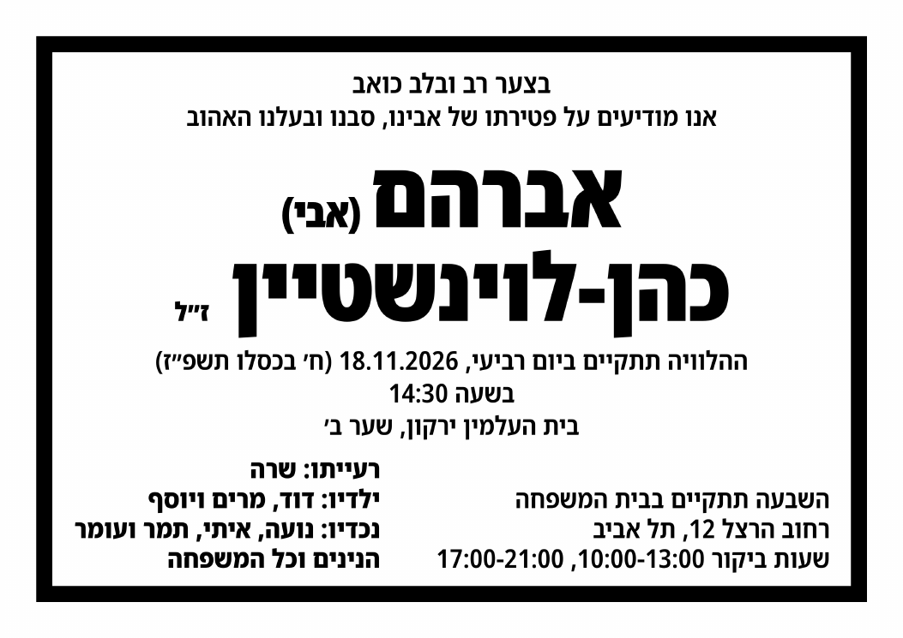
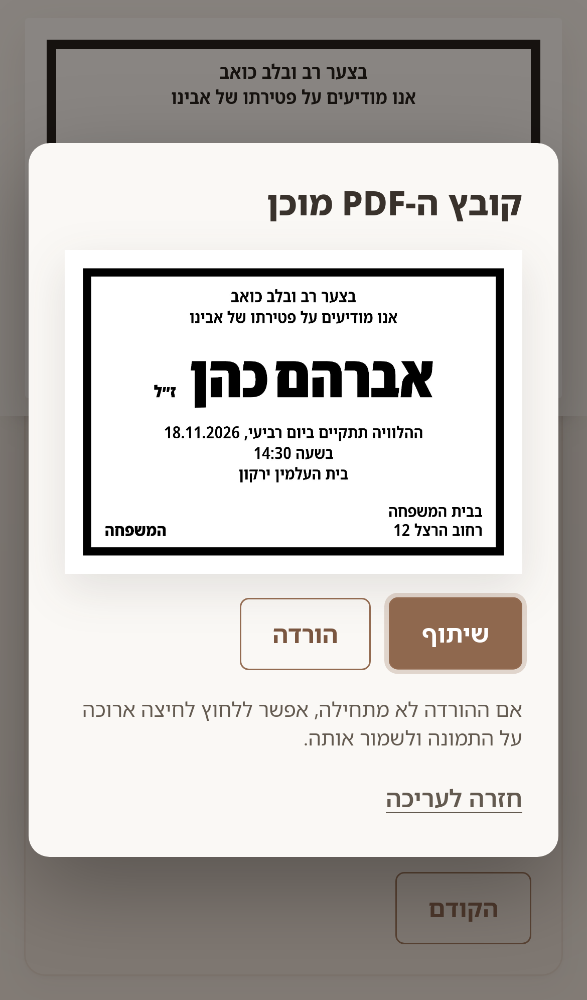
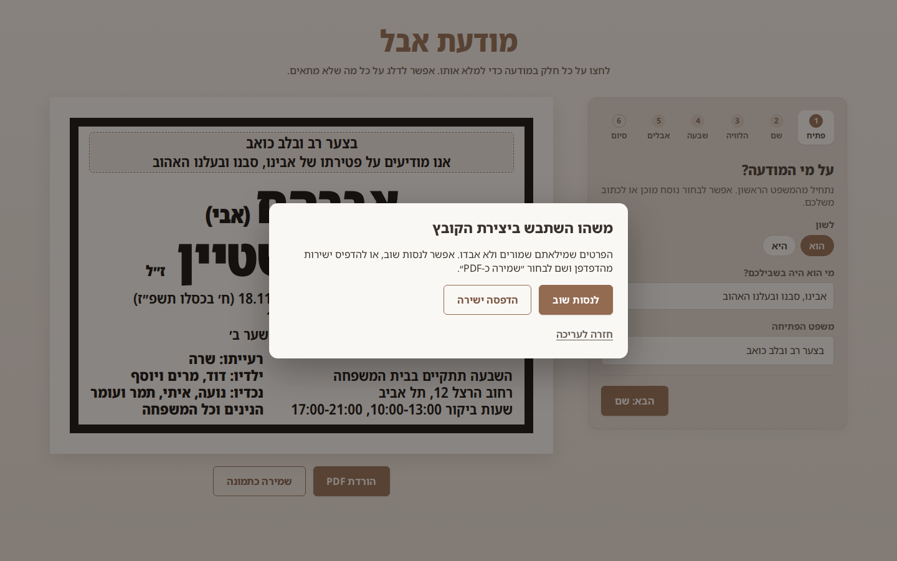
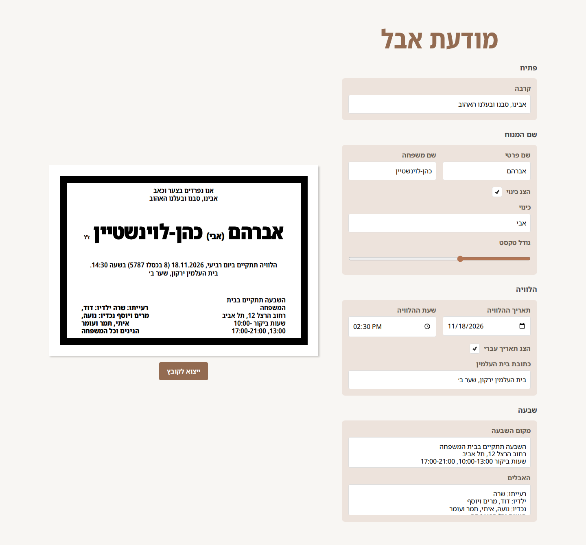

# EvelPost: from a form to the notice itself

**The product story.** EvelPost helps a family put together a death notice
(מודעת אבל) in minutes. Versions 1 and 2 gave people a form to fill in.
Version 3 lets them shape the notice directly. This document explains who
it's for, what was wrong with the form, and the design decisions behind the
change. How it's built is kept apart in [technical-notes.md](technical-notes.md).

| | |
| --- | --- |
| Before | [v2, the live version](v2-production.md): a 16-field form beside a preview |
| After | [v3](v3-notice-first.md): the notice is the interface |

*v2: a form, and a preview of the result.*

*v3: the same notice, edited in place.*

## Why it exists

Writing a notice for a loved family member, with the tools available online,
was harder than it should have been: clunky interfaces, no care for the
culture, and technical problems at the worst possible moment. EvelPost began
as a response to that, and the goals that came out of it still decide every
choice: simple, customisable, accessible, free, similar to the familiar
format, and printable at home.

## Who it's for, and the moment they're in

The person using EvelPost is usually not an expert in anything. They are a
family member who has been asked to "take care of the notice", often within a
day or two of the death, often on a phone, often while being interrupted by
calls and relatives. Details arrive piece by piece: the funeral time is
confirmed later, the shiva address later still. They may have never made one
before. They want it to look right the first time, because it will be
printed, posted and sent around.

Different families also need different words: a mother and a father, a rabbi
and a teacher, a religious burial and a civil farewell.

> This portrait comes from the original experience behind the project and
> from reviewing the product. It hasn't been tested with users yet. See
> [What this is based on](#what-this-is-based-on).

## What a good experience has to be

| Principle | In practice |
| --- | --- |
| **Calm** | Nothing makes a person feel behind, wrong or tested. |
| **Recognisable** | The result looks like the notices people already know. |
| **Inclusive** | One familiar structure, wording that fits many families. |
| **Forgiving** | Skip anything, change anything, lose nothing. |
| **Trustworthy at the end** | The file is right the first time they save it. |

## The problem with the form

v1 and v2 followed the usual pattern: a column of fields, and a preview of the
result. It looks tidy, but it asks a person in grief to do three things:

1. **Translate.** Read a field label ("קרבה", "כתובת בית העלמין") and
   imagine where its answer will land on the notice.
2. **Look back and forth** between the fields and the preview to check.
3. **Trust** that a half-finished notice will turn out right.

And in v2 the empty and half-filled notice looked broken: a lone `ז"ל`,
`הלוויה תתקיים ב,`, `בשעה .` Fragments like that read as errors, at the
moment a person least needs to feel they're getting something wrong.

| v2, before anything is typed | v3, before anything is typed |
| --- | --- |
|  |  |

## The change: show the notice, not a form

People already know what a death notice looks like. So in v3 the page opens
on a notice, with faded examples in the places still to be filled in, and
**each part of the notice is the control for that part**: tap the name to
write the name, tap the funeral details to write the funeral. A short step
opens with only the questions for that part, phrased the way a person would
ask them: *על מי המודעה?* · *מתי ואיפה נפרדים?* · *איפה יושבים שבעה?* · *מי
האבלים?*

Anyone who prefers to be led can follow the numbered steps with "הבא"; nobody
is forced to.

|  | v2 | v3 |
| --- | --- | --- |
| What you see first | A long form, and an empty frame | The notice, with examples in place |
| What you decide first | Where to start among 16 fields | Which part you want to write |
| What's on screen at once | 16 fields | One step: 1 to 8 controls |
| How you check your work | Look away from the field to the preview | The text changes where you are typing |
| A half-finished notice | Looks broken | Always looks like a notice |

## The journey, before and after

| Moment | v1 and v2 | v3 |
| --- | --- | --- |
| **Arriving** | A form. The notice is a by-product. | The notice, with a one-line invitation: *tap any part to fill it in; skip anything that doesn't fit.* |
| **Writing** | Type, look at the preview, repeat. On a phone the preview is below the whole form, so you type blind. | The notice is pinned above the fields on a phone and stays beside them on a desktop. |
| **Missing details** | The notice shows broken fragments. | Faded examples. Missing details are only mentioned on the last step, as tappable chips, never as errors. |
| **Lots of text** | The text is silently cut off at the frame. In our test notice, two of the four mourner lines and part of the shiva details disappeared. | The text shrinks to fit. Nothing is lost. |
| **Their family** | One wording: a man, `ז"ל`. | הוא or היא, a choice of honorific, a civil ceremony, an optional opening. |
| **Checking** | Same view as while typing. | The last step shows exactly what will be saved. |
| **Saving** | The browser's print dialog, whose result depends on the browser. | A real PDF or image, previewed before it is saved. |
| **Sharing** | Not supported. | On phones, the share sheet (WhatsApp and the like). |
| **Starting over** | Reset deletes everything at once. | It asks first. Drafts save themselves. |

*On a phone, from left: the first prototype, form and preview, v1, v2, v3. In
every version before v3 the notice sits under the whole form.*

## Design decisions, and what each one costs

### 1. Show the thing, not the form

- **What we saw.** A form makes people think in data ("fill in the relation
  field"), and a notice is something they already understand as a whole.
- **What we decided.** The notice is the interface. Each part is a button
  (mouse, touch or keyboard) that opens its own short step. The active part
  is outlined on the notice, so it's always clear what you are editing.
- **What it costs.** An overview of every field at once is gone, and tapping
  a picture is less obvious than filling a field. We compensate with a line of
  instruction under the title, an outline when you hover or focus a part, a
  numbered step row and a "next" button: three ways in, all landing on the same
  place. *Whether people discover this unaided is the first thing to test.*

### 2. Guidance without pressure

- **What we saw.** Nearly every detail of a notice arrives late or is
  optional, and a form that insists on all of it makes people feel behind.
- **What we decided.** Nothing is required. Empty places show a faded example
  of what could go there. The last step lists what's still empty as small
  tappable chips, and the tone is "you haven't filled in" rather than
  "error".
- **What it costs.** The product no longer prevents an incomplete notice. We
  accept that, because a notice with the funeral time still to come is
  normal, and the person knows their own situation better than we do.

### 3. One structure, many families

- **What we saw.** The first version could only write a notice for a man, with
  `ז"ל` after the name. Anyone else got the wrong words and had to fix them
  on paper.
- **What we decided.** Keep the familiar structure and let the wording change
  inside it: הוא / היא (פטירתו / פטירתה, and the questions follow), an honorific
  after the name (ז״ל, ע״ה, זצ״ל, הי״ד or none), a ceremony (הלוויה, הלוויה
  אזרחית or טקס פרידה, with the grammar following), and an optional opening
  line.
- **What it costs.** These are curated lists, not free text, and they don't
  cover every community. The wording was written by us and **must be
  reviewed by people from the communities it serves**, religious and secular,
  before we call it done.

### 4. The notice always fits

- **What we saw.** In v1 and v2, adding more text meant it was silently cut
  off at the frame. The only control was a size slider for the name.
- **What we decided.** The text finds its own size, so everything that was
  typed is visible, a long name shrinks by itself, and the person's own line
  breaks stay where they put them (an address is not re-wrapped).
- **What it costs.** Very long content makes small text, and the notice is
  always a single page. We chose that over a notice that hides words or
  spills onto a second sheet.

### 5. Finish properly

- **What we saw.** The hardest moment to fail is the last one, after someone
  has filled everything in. In v2 the final step is handed to the browser's
  print dialog. When we ran the test notice through it, the page came out
  shifted and split over two sheets (in Chromium's print-to-PDF, not yet
  seen on a real device).

  | v2 export, page 1 | v2 export, page 2 |
  | --- | --- |
  |  |  |

- **What we decided.** The product makes the file itself, as an exact A4 PDF
  or an image, and shows it before it is saved, so nobody downloads a
  surprise. On phones it opens the share sheet. If something does go wrong,
  the message says the details are safe and offers to try again or print
  directly. A broken file is never handed over.

  

  | The result, on a phone | If something fails |
  | --- | --- |
  |  |  |

- **What it costs.** The PDF is a high-resolution picture of the notice, so
  its text can't be selected or searched. That's what makes it look identical
  in every browser.

### 6. See it while you type

- **What we saw.** On a phone, the notice was at the bottom of a long form.
- **What we decided.** The notice is pinned to the top of the screen, and the
  step the person is editing sits below it.
- **What it costs.** The notice takes up a good part of a small screen, so
  each step is kept short.

*The last step: the notice as it will be saved, and a gentle list of what's
still empty.*

## What stayed the same

The warm palette and the typeface, the heavy black frame people recognise,
the Hebrew date in Hebrew numerals, the saved draft, and the idea that the
notice looks the same on screen, on paper and as a file. A draft written in
v2 opens in v3 with everything in place, so nobody loses work when the new
version goes live.

## How it got here

| When | Version | What changed for the user |
| --- | --- | --- |
| Dec 2023 | Prototype | A form above a live notice; text sized relative to the page (a contribution by guychouk). |
| Dec 2023 | Form & preview | Grouped sections, the warm palette, the form and the notice side by side, optional nickname and Hebrew date. |
| Jan–Feb 2024 | **v1** | Export through the print dialog; a phone layout. |
| Jun 2026 | **v2** (live today) | Opening lines to choose from, optional title, Hebrew dates in Hebrew numerals, saved drafts, safer handling of what people type. |
| Nov 2026 | **v3** | A different model: the notice is the interface. Inclusive wording, text that fits, a reliable file, sharing. |

Between v1 and v2 the improvements were real but stayed inside the same
model: a form beside a preview. v3 is the first version that changes the
model.

*v1 (Feb 2024).*

*The first prototype (Dec 2023): note that the text is already cut off.*

## What this is based on

Being clear about this matters more than sounding certain.

- **What we did:** a design review of the live product (v2) against the
  project's goals and common usability principles, with the same test notice
  entered in every version; measuring the actual output (page counts, cut-off
  text, the empty state); and testing v3 in three browser engines, and in
  iPhone and Android emulation.
- **What we have not done:** user testing. The picture of the person and
  their moment is informed by the original experience, not by interviews.
  Claims such as "easier" are design judgements until people have tried it.
- **Not yet tested:** a real phone's share sheet, WhatsApp's in-app browser,
  real Safari, printing on paper.

### What we'd do next

1. **Try it with five people**, on their phones, each making a notice from a
   short made-up scenario (including one with a woman and one civil
   ceremony). Watch where they hesitate. Does anyone fail to find that the
   notice is tappable? Does anyone get stuck at the end?
2. **Have the wording reviewed** by people from different communities.
3. **Compare with v2** if possible: the same scenario on both, to see whether
   v3 is actually faster and calmer rather than just different.

## Read more

- [v2: the live version](v2-production.md): what it does and where people run
  into trouble.
- [v3: the new version](v3-notice-first.md): what it does.
- [technical-notes.md](technical-notes.md): how it's built and tested, and the
  test notice used in every screenshot.
- [../CHANGELOG.md](../CHANGELOG.md)
