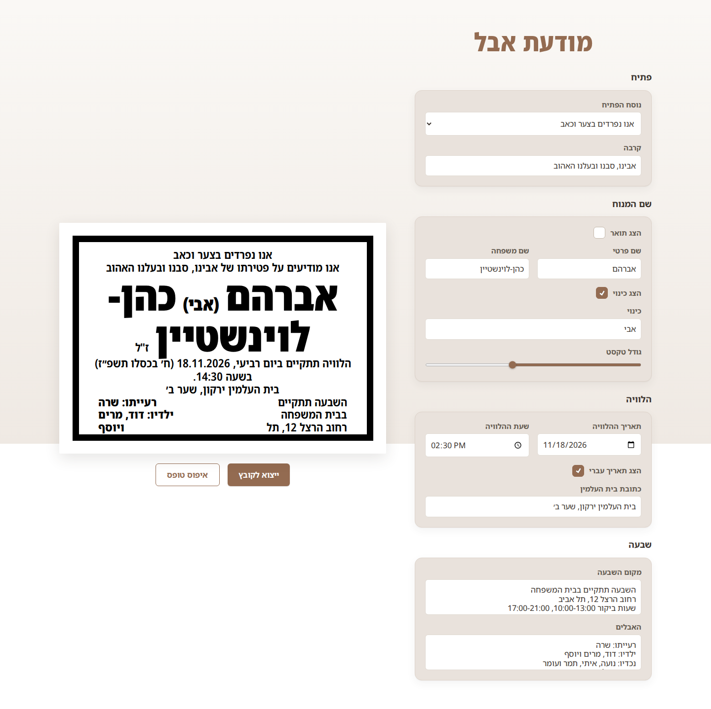
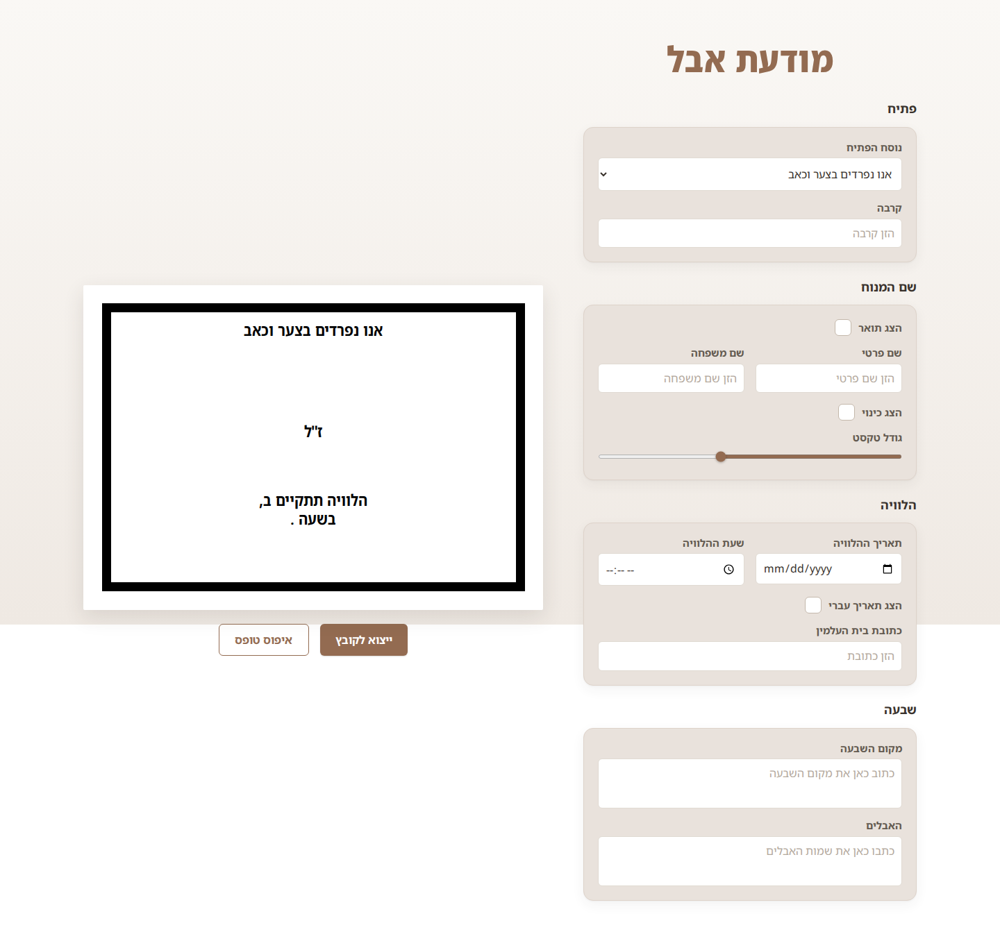
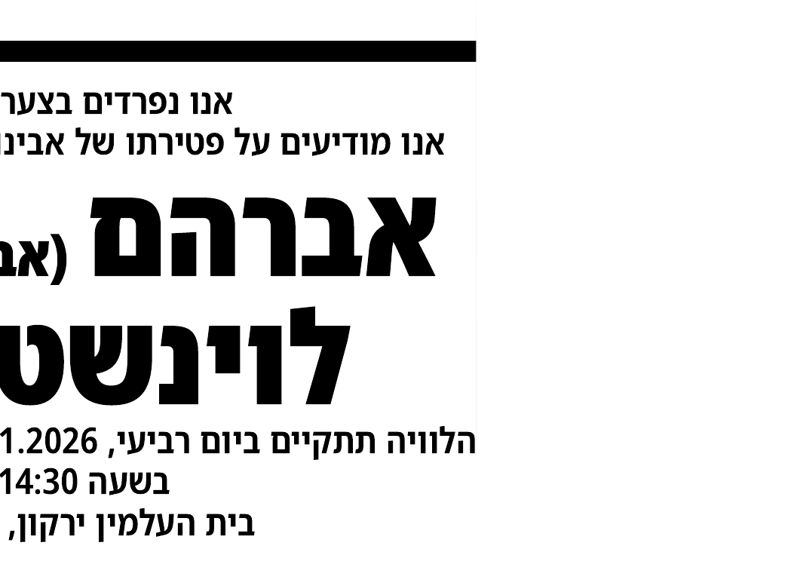

# v2: the production version (June 2026)

A record of EvelPost as it is live today, written before v3 replaces it.

| | |
| --- | --- |
| Live at | https://timonim.github.io/EvelPost/ (GitHub Pages, `master`) |
| Code | commit `ae58f74`, 24 June 2026; git tag `v2` |
| Run this exact version | `git checkout v2 && python3 -m http.server 8000` |
| Files | `index.html`, `styles.css`, `script.js`, `README.md` |



## What the user sees

A page with a form on the right and the notice on the left (stacked on
screens narrower than 1000 px, with the form first). The notice updates as
the person types. Below it: ייצוא לקובץ (export) and איפוס טופס (reset).

### The form

| Section | Field | Type | Notes |
| --- | --- | --- | --- |
| פתיח | נוסח הפתיח | select | 4 preset lines, or "custom" |
| | פתיח מותאם אישית | text | Shown only for "custom" |
| | קרבה | text | e.g. אבינו היקר |
| שם המנוח | הצג תואר | checkbox | Shows the title field |
| | תואר | text | e.g. ד״ר |
| | שם פרטי, שם משפחה | text | Side by side |
| | הצג כינוי | checkbox | Shows the nickname field |
| | כינוי | text | Shown in parentheses |
| | גודל טקסט | range 0.8–2.8 | Size of the name |
| הלוויה | תאריך, שעה | date, time | |
| | הצג תאריך עברי | checkbox | Hebrew date in Hebrew numerals |
| | כתובת בית העלמין | text | |
| שבעה | מקום השבעה | textarea | Line breaks kept |
| | האבלים | textarea | Line breaks kept |

### The notice it produces

```
{opening line}
אנו מודיעים על פטירתו של {relation}          (only when a relation is given)
{title} {first name} ({nickname}) {last name} ז"ל
הלוויה תתקיים ב{weekday}, {dd.mm.yyyy} ({Hebrew date})
בשעה {time}.
{location}
{shiva}                                        {mourners}
```

Inside a heavy black frame on a white A4-landscape page.

### Export

ייצוא לקובץ opens a new window, writes the notice into it with the app's
stylesheet and an `@page { size: A4 landscape; margin: 0 }` rule, waits for
fonts, and calls the browser's print dialog. The person saves a PDF or
prints from there. On desktop the window closes after the dialog; on phones
it stays open. If pop-ups are blocked, an alert asks to allow them.

### Other behaviour

- Every change is saved to `localStorage` (`evelpost-form`) and restored on
  reload. Reset clears the form and the saved draft at once, with no
  confirmation.
- User text is HTML-escaped before it is inserted into the notice.
- Dates from the date field are parsed as local dates, so the day can't shift
  by time zone.
- The notice measures everything in `cqw` (percent of its own width), so its
  proportions are the same on screen and on paper.

## Technology

Plain HTML, CSS and JavaScript, no build step. External requests: Google
Fonts (Noto Sans Hebrew, variable width and weight) and `normalize.css` from
cdnjs.

## Known issues

Found in a review in November 2026, each reproduced with the
[test notice](evolution.md#the-test-notice) unless stated.

1. **Text is cut off without warning.** The notice has a fixed text size and
   `overflow: hidden`. With the test notice, the last shiva line and two of
   the four mourner lines are missing, on screen and in the export.
2. **The export can come out broken.** Through Chromium's print-to-PDF at
   100% scale, the test notice came out shifted and split across two pages
   (images below). Likely cause: the export window's `body` keeps the app's
   flex-centred layout and is not sized to the page, so the notice is placed
   against the window. Not observed on a real device; the browser's "fit to
   page" setting may hide it.
3. **Male-only wording.** `פטירתו של` and `ז"ל` are fixed; a notice for a
   woman reads wrongly and there is no way to change the honorific.
4. **The empty state looks broken.** Before the form is filled, the notice
   shows fragments: a lone `ז"ל`, `הלוויה תתקיים ב,`, `בשעה .`.
5. **Long names wrap badly.** `כהן-לוינשטיין` breaks after the hyphen,
   leaving `כהן-` on its own line.
6. **The result is out of view while typing.** On phones the notice is below
   the whole form; on desktop it scrolls away with the page.
7. **Only the print dialog.** No image to share, and the result depends on
   each browser's print settings and pop-up blocking.
8. **Depends on outside services** for the font and the CSS reset.
9. **Smaller:** placeholder text at 2.3:1 contrast (below the 4.5:1 guideline);
   English page title; heavy frame and landscape only.

| Empty state | Export, page 1 | Export, page 2 |
| --- | --- | --- |
|  |  |  |

## What v2 improved over v1

v2 (June 2026) rewrote the February 2024 version: a choice of opening lines,
the optional title, Hebrew numerals in the Hebrew date (v1 printed
`8 בכסלו 5787`), the page declared as Hebrew and right-to-left (v1 was
`lang="en"`), escaping of user text (v1 inserted it raw), local date parsing,
mourner line breaks (v1 lost them), saved drafts and reset, a notice sized to
its own width, and an export that waits for fonts instead of a load event that
could already have fired. See [evolution.md](evolution.md#timeline).
