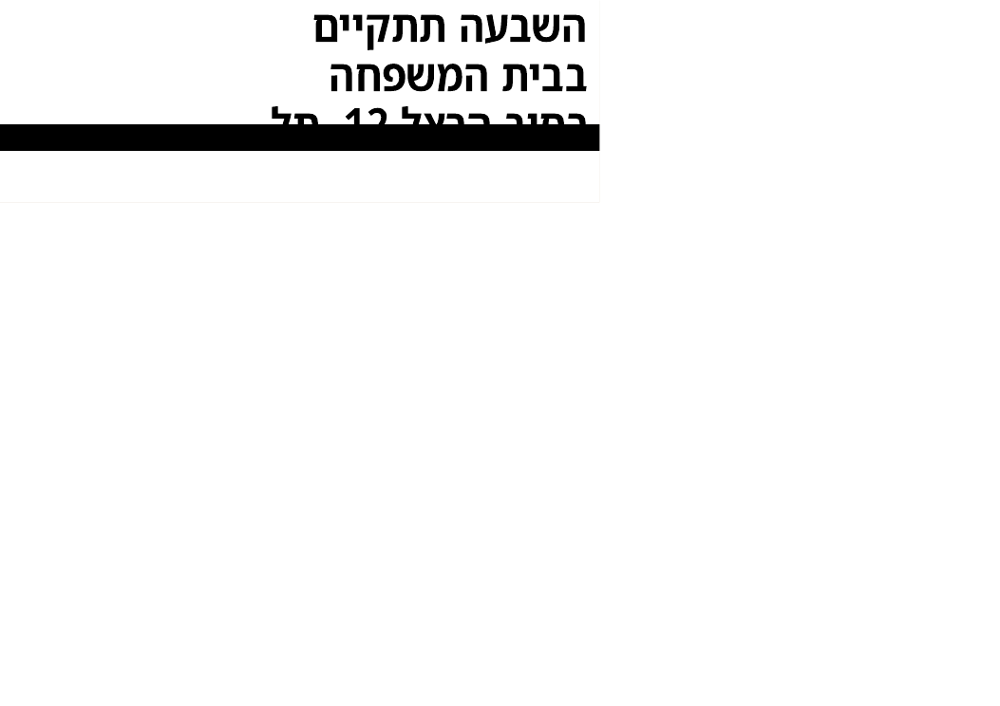

# v2: the production version (June 2026)

A record of EvelPost as it is live today, written before v3 replaces it. The
story of what changed next is in [evolution.md](evolution.md).

| | |
| --- | --- |
| Live at | https://timonim.github.io/EvelPost/ (GitHub Pages, `master`) |
| Code | commit `ae58f74`, 24 June 2026; git tag `v2` |
| Run this exact version | `git checkout v2 && python3 -m http.server 8000` |
| Files | `index.html`, `styles.css`, `script.js`, `README.md` |


## What the user sees

A page with a form on the right and the notice on the left (stacked on
screens narrower than 1000 px, with the form first). The notice updates as
the person types. Below it: ייצוא לקובץ (export) and איפוס טופס (reset).

### The form

| Section | Field | Type | Notes |
| --- | --- | --- | --- |
| פתיח | נוסח הפתיח | select | 4 preset lines, or "custom" |
| | פתיח מותאם אישית | text | Shown only for "custom" |
| | קרבה | text | e.g. אבינו היקר |
| שם המנוח | הצג תואר | checkbox | Shows the title field |
| | תואר | text | e.g. ד״ר |
| | שם פרטי, שם משפחה | text | Side by side |
| | הצג כינוי | checkbox | Shows the nickname field |
| | כינוי | text | Shown in parentheses |
| | גודל טקסט | range 0.8–2.8 | Size of the name |
| הלוויה | תאריך, שעה | date, time | |
| | הצג תאריך עברי | checkbox | Hebrew date in Hebrew numerals |
| | כתובת בית העלמין | text | |
| שבעה | מקום השבעה | textarea | Line breaks kept |
| | האבלים | textarea | Line breaks kept |

### The notice it produces

```
{opening line}
אנו מודיעים על פטירתו של {relation}          (only when a relation is given)
{title} {first name} ({nickname}) {last name} ז"ל
הלוויה תתקיים ב{weekday}, {dd.mm.yyyy} ({Hebrew date})
בשעה {time}.
{location}
{shiva}                                        {mourners}
```

Inside a heavy black frame on a white A4-landscape page.

### Export

ייצוא לקובץ opens a new window, writes the notice into it with the app's
stylesheet and an `@page { size: A4 landscape; margin: 0 }` rule, waits for
fonts, and calls the browser's print dialog. The person saves a PDF or
prints from there. On desktop the window closes after the dialog; on phones
it stays open. If pop-ups are blocked, an alert asks to allow them.

### Other behaviour

- Every change is saved to `localStorage` (`evelpost-form`) and restored on
  reload. Reset clears the form and the saved draft at once, with no
  confirmation.
- User text is HTML-escaped before it is inserted into the notice.
- Dates from the date field are parsed as local dates, so the day can't shift
  by time zone.
- The notice measures everything in `cqw` (percent of its own width), so its
  proportions are the same on screen and on paper.

## Technology

Plain HTML, CSS and JavaScript, no build step. It loads Google Fonts (Noto
Sans Hebrew) and `normalize.css` from outside servers.

## Where people run into trouble

Found in a design review in November 2026, using the
[test notice](technical-notes.md#the-test-notice). None of this has been seen
with real users yet.

| What a person experiences | Why it matters | Cause, briefly |
| --- | --- | --- |
| **Their words disappear.** With the test notice, two of the four mourner lines and part of the shiva details are cut off, on screen and in the file. Nothing says so. | They may print and post a notice that's missing family members, and not notice. | A fixed text size inside a frame that hides overflow. |
| **The final file can come out wrong.** The test notice exported to two sheets, shifted off the page (see below). | The last step is the one where a failure costs the most. | The export window keeps the page's layout instead of being sized to A4. Reproduced in Chromium's print engine; not seen on a real device. |
| **The empty notice looks broken.** A lone `ז"ל`, `הלוויה תתקיים ב,`, `בשעה .` | Fragments read as errors, at the moment someone most needs reassurance. | The notice is assembled from whatever is filled in. |
| **The wording only fits a man.** `פטירתו של` and `ז"ל` are fixed. | A notice for a woman, or for a family that doesn't use `ז"ל`, has to be corrected on paper. | Hard-coded text. |
| **They can't see the result while typing.** On a phone, the notice is below the whole form. | They type blind, then scroll down to check. | Form first, preview second. |
| **Long names break badly.** `כהן-לוינשטיין` splits after the hyphen, leaving `כהן-` alone on a line. | Looks careless on a notice. | Names wrap like normal text. |
| **No way to send it.** The only output is the browser's print dialog. | Most notices are shared by phone, not just printed; a PDF has to be saved and found again first. | No image or share option. |
| **A lot to take in at once.** 16 fields on one page. | Heavy for someone in a hurry and in grief. | The form model. |

Smaller: the page title is in English; placeholder text has 2.3:1 contrast
(below the 4.5:1 guideline); the heavy frame and landscape are the only
choices; "reset" deletes everything with no confirmation; the page depends on
outside servers for its font.

| Empty state | Export, sheet 1 | Export, sheet 2 |
| --- | --- | --- |
|  |  |  |

How these were found and measured: [technical-notes.md](technical-notes.md).

## What v2 improved over v1

v2 (June 2026) rewrote the February 2024 version: a choice of opening lines,
the optional title, Hebrew numerals in the Hebrew date (v1 printed
`8 בכסלו 5787`), the page declared as Hebrew and right-to-left (v1 was
`lang="en"`), escaping of user text (v1 inserted it raw), local date parsing,
mourner line breaks (v1 lost them), saved drafts and reset, a notice sized to
its own width, and an export that waits for fonts instead of a load event that
could already have fired. See [evolution.md](evolution.md#how-it-got-here).
