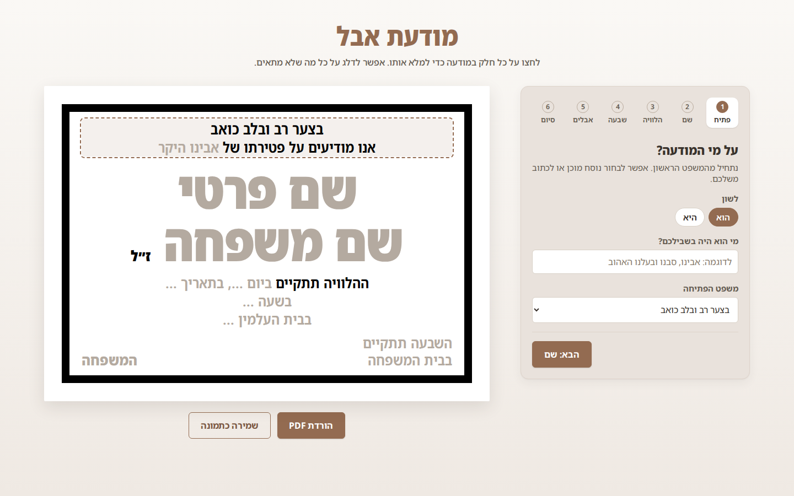
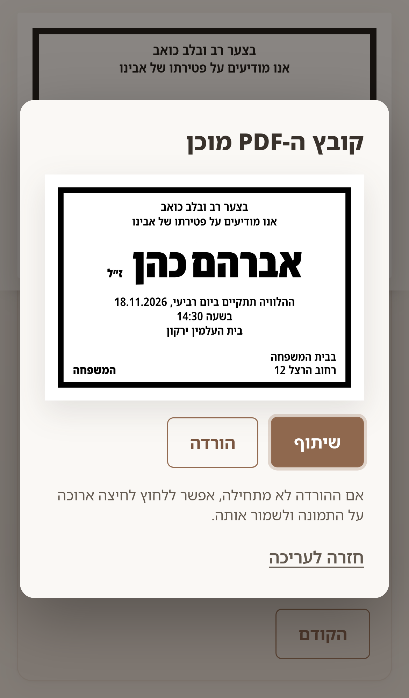
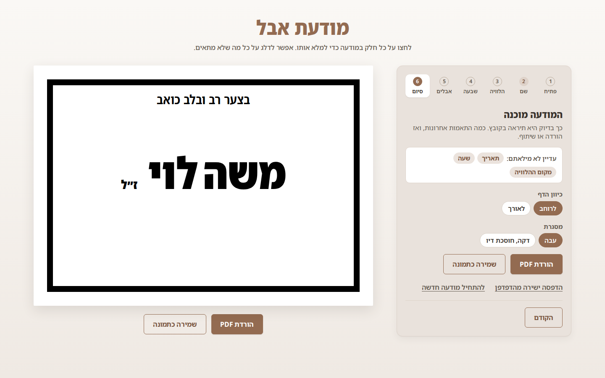

# v3: the notice-first version (November 2026)

| | |
| --- | --- |
| Status | In review on branch `notice-first-editor`; replaces v2 when merged |
| Why it changed | [evolution.md](evolution.md) |
| How it works inside | [technical-notes.md](technical-notes.md) |



## What a person does

The page opens on a notice with faded examples in the places still to fill.
They tap a part of the notice, a short step opens for just that part, and the
notice changes as they type. They can also follow the numbered steps with
"הבא". Nothing is required.

| Step | The part of the notice | The question | What it asks |
| --- | --- | --- | --- |
| 1 פתיח | Opening lines | על מי המודעה? | הוא / היא; who they were to the family; an opening line (four to choose from, their own, or none) |
| 2 שם | The name | השם במודעה | First and last name; optional title and nickname; what follows the name; name size |
| 3 הלוויה | The funeral | מתי ואיפה נפרדים? | The ceremony; date, time, optional Hebrew date; place |
| 4 שבעה | The shiva | איפה יושבים שבעה? | Free text |
| 5 אבלים | The mourners | מי האבלים? | Free text, one line per name or group |
| 6 סיום | The whole notice | המודעה מוכנה | Page direction, frame; what's still empty; save and share |

On a phone the notice is pinned above the step. On a desktop it stays beside
it.

## What the notice says

```
{opening line}                                   (optional)
אנו מודיעים על פטירתו|פטירתה של {relation}
{title} {first} ({nickname}) {last} {honorific}   ז״ל · ע״ה · זצ״ל · הי״ד · none
{ceremony} ב{weekday}, {date} ({Hebrew date})
בשעה {time}
{place}
{shiva}                                {mourners}
```

The ceremony reads *ההלוויה תתקיים*, *ההלוויה האזרחית תתקיים* or *טקס הפרידה
יתקיים*. In portrait, the shiva and mourners stack and centre.

- **Empty places** show a faded example. On the last step, and in every file,
  the examples are removed, and so is any line that would read as incomplete
  without them.
- **Text fits.** Nothing is cut off; the text shrinks instead. Line breaks stay
  where the person put them, and times like `10:00-13:00` never split.
- **Options:** landscape or portrait; a heavy frame, or a thin one that saves ink.

## Saving and sharing

הורדת PDF · שמירה כתמונה · a direct-print link, as a fallback.

A dialog shows the actual file before it is saved. On a phone it offers the
share sheet; on a desktop, download and "open and print". If something goes
wrong it says the details are safe and offers to try again. See the
[export design decision](evolution.md#5-finish-properly).

| The result, on a phone | The last step, with what's still empty |
| --- | --- |
|  |  |

## Their work is kept

Drafts save as people type, in the browser. A draft from v2 opens in v3 with
everything in place. "Start a new notice" asks first.

## Limits, for now

- The PDF holds a picture of the notice, so its text can't be selected or
  searched. In exchange, it looks the same in every browser.
- Very long content makes the text small; the notice is always one page.
- The lists of honorifics and ceremonies are fixed, and the Hebrew wording
  hasn't been reviewed by people from the communities it's meant to serve.
- Not yet tried by real users, or on a real phone's share sheet, in WhatsApp's
  built-in browser, in Safari on a Mac, or on paper. Details:
  [technical-notes.md](technical-notes.md#what-was-tested).
